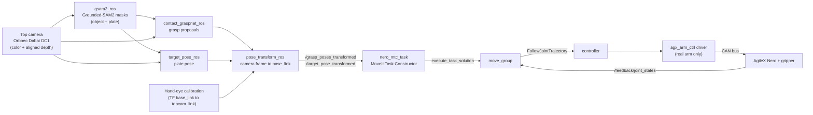

# Nero pick-and-place pipeline

Language-prompted pick-and-place for an **AgileX Nero 7-DOF arm** (agx gripper) on a Jetson, using a
top-down RGB-D camera for perception and **MoveIt Task Constructor (MTC)** for planning.
You tell the system what to pick ("a green cube.") and it finds the object and a plate, proposes
grasps, plans pick, transit, place and retreat, and executes it in simulation or on the real arm.

This folder contains the launch scripts, helper tools, configuration snapshots and **all project
documentation**: how to install it, how to run it, why every important decision was made, what was
tried and failed, and what is still open.

> **If you only have 10 minutes:** read [Status at a glance](#status-at-a-glance), then
> [`docs/07_development_log.md`](docs/07_development_log.md) (the story of the project), then
> [`docs/09_known_issues_and_next_steps.md`](docs/09_known_issues_and_next_steps.md).

---

## Status at a glance

State of the project as of **2026-10-08** (end of the last recorded working session).

| Area | State | Notes |
|---|---|---|
| Perception chain (segment, grasps, plate pose, transform to `base_link`) | Works end to end | Grasps now land on the object (operator report, 2026-10-08). The earlier grasp-quality investigation is kept as a record in [`docs/10_grasp_quality_investigation.md`](docs/10_grasp_quality_investigation.md) |
| Hand-eye calibration (top camera, eye-on-base) | **Hand-adjusted, working in practice** | A recalibration attempt on 2026-10-07 was judged worse and rejected; the values in use were adjusted by hand and grasps now land correctly. They did not come from a clean recalibration run, so [`docs/03_calibration.md`](docs/03_calibration.md) explains how to redo it |
| Planning with MTC (pregrasp, approach, lift, transit, place, retreat) | Works in simulation and on the real arm | Place fails if the plate is more than about 0.55 m from the arm base (reach limit, [docs/09](docs/09_known_issues_and_next_steps.md)) |
| Execution | Works in simulation and on the real arm at reduced speed (0.1 rad/s per joint) | Execution is sent through our own code path, not the RViz panel button, see [docs/06](docs/06_tuning_reference.md) |
| Grasp accuracy on the real arm | **Working well** | Operator report, 2026-10-08. The operator attributes it to **sorting the grasp candidates most top-down first** before they are handed to MTC ([docs/07](docs/07_development_log.md) stage 12, [docs/06](docs/06_tuning_reference.md)) |
| Safety | Software stop only (this arm has **no physical e-stop**) | Read [`docs/05_run_real_arm.md`](docs/05_run_real_arm.md) before moving the real arm |
| Reproducibility | Environment and package snapshots are generated by `maintainer/collect_from_workspace.sh` | Run it once on the reference machine before pushing |

---

## How it works



1. **Segmentation** (`gsam2_ros`): a text prompt (for example `a green cube.`) and a plate prompt are
   turned into two masks on the color image with Grounded-SAM2.
2. **Grasp proposals** (`contact_graspnet_ros`): Contact-GraspNet predicts grasp poses on the masked
   object from the depth image.
3. **Plate pose** (`target_pose_ros`): the top surface of the plate becomes the place target.
4. **Frame change** (`pose_transform_ros`): both results are moved from the camera frame into
   `base_link` using the TF published from the hand-eye calibration.
5. **Planning** (`nero_mtc_task`): MTC builds a task: current state, connect to pregrasp, pregrasp,
   open gripper, straight-line approach, close and attach, lift, transit, place, release, retreat.
6. **Execution**: the chosen solution is retimed to a speed limit and sent to `move_group`'s
   `execute_task_solution` action. On the real arm a driver turns the controller output into CAN commands.

A longer description with frames, topics and design decisions is in
[`docs/01_system_overview.md`](docs/01_system_overview.md).

---

## Repository map

| Path | What it is |
|---|---|
| [`docs/`](docs/) | All documentation, numbered in reading order (index below) |
| [`launch/`](launch/) | The pipeline launch folder. On the reference machine it lives at `~/nero_pipeline_launch` (symlink, see [docs/02](docs/02_install_and_environment.md)) |
| [`launch/start_pipeline.sh`](launch/start_pipeline.sh) | Starts arm (sim or real), camera, calibration publisher and all perception nodes |
| [`launch/run_pick_and_place.sh`](launch/run_pick_and_place.sh) | Runs the four perception steps, then MTC planning, optionally execution (`MTC_EXECUTE=y`) |
| [`launch/stop_arm.sh`](launch/stop_arm.sh) | Software stop for the real arm |
| [`launch/scripts/`](launch/scripts/) | Arm launchers (`launch_arm.sh`, `launch_arm_real.sh`), table collision, start-pose move, monitor |
| [`launch/tools/`](launch/tools/) | Diagnostic and helper tools (grasp viewer, calibration helpers, reach checks) |
| [`config_snapshots/`](config_snapshots/) | Copies of the configuration files we changed in third-party packages and the calibration file |
| [`reference_copies/`](reference_copies/) | Read-only copies of source files that live in other repositories (so you can read the final code here) |
| [`packages/`](packages/) | Snapshot of our five ROS packages, as they were on the lab machine when this repository was assembled |
| [`environments/`](environments/) | Frozen environment lists (conda envs, pip, apt, system info), generated |
| [`patches/`](patches/) | `git diff` of local modifications to third-party repositories, generated |
| [`maintainer/`](maintainer/) | Scripts for the person who updates this folder |

### Documentation index

| # | Document | Read it when |
|---|---|---|
| 01 | [System overview](docs/01_system_overview.md) | You want the architecture, frames and topics |
| 02 | [Install and environment](docs/02_install_and_environment.md) | You are setting up a machine |
| 03 | [Calibration](docs/03_calibration.md) | Point cloud and arm do not line up |
| 04 | [Run in simulation](docs/04_run_simulation.md) | First run, no hardware risk |
| 05 | [Run the real arm](docs/05_run_real_arm.md) | Before the arm moves. Contains the safety protocol |
| 06 | [Tuning reference](docs/06_tuning_reference.md) | You want to change a number and know what it does |
| 07 | [Development log](docs/07_development_log.md) | You want to know what was done, tried and failed, in order |
| 08 | [Troubleshooting](docs/08_troubleshooting.md) | Something broke |
| 09 | [Known issues and next steps](docs/09_known_issues_and_next_steps.md) | You are deciding what to work on |
| 10 | [Grasp quality investigation](docs/10_grasp_quality_investigation.md) | You work on grasp quality |

---

## Quick start for a new person

0. **Get the code** (the umbrella repository holds our packages as submodules and this folder):

   ```bash
   git clone --recurse-submodules https://github.com/AI-DA-STC/near-agilex-manipulation-base.git ~/near-agilex-manipulation-base
   ln -s ~/near-agilex-manipulation-base/nero_pipeline/launch ~/nero_pipeline_launch
   ```

   Our packages must then be placed in the ROS workspace `~/agx_arm_ws/src/` and built, see
   [docs/02](docs/02_install_and_environment.md) section 2.8. `docs/PACKAGE_VERSIONS.md` (generated) lists the exact
   repository and commit of every package.
1. **Read** the status table above and [docs/01](docs/01_system_overview.md).
2. **Check the machine** against [docs/02](docs/02_install_and_environment.md) (the checklist at its end lists
   one command per requirement). Run `maintainer/verify_repo.sh` to check this folder is complete.
3. **Run in simulation first**, following [docs/04](docs/04_run_simulation.md).
4. **Only then** move to the real arm, following [docs/05](docs/05_run_real_arm.md), including the
   safety protocol and the plan-only first run.

## Conventions used in every document

* Commands are meant to be copied as shown. A block starting with `conda deactivate` means exactly that:
  **ROS commands must run with conda deactivated**, because conda's Python cannot import `rclpy`.
  The two conda environments (`grounded_sam2`, `contact_graspnet`) are only used by the perception nodes
  and by the helper tools that say so.
* Workspace layout used throughout: ROS workspace `~/agx_arm_ws`, launch folder `~/nero_pipeline_launch`,
  Contact-GraspNet in `~/contact_graspnet_pytorch`.
* Frames: `base_link` is the arm base, `topcam_link` the top camera, `tcp_link` the gripper
  (its +Z axis is the approach direction). Distances are metres, angles radians unless a column says degrees.
* "Last known value" in the tuning tables means the value in use at the end of the last working session.
  Always confirm the current value with `maintainer/verify_repo.sh`.
