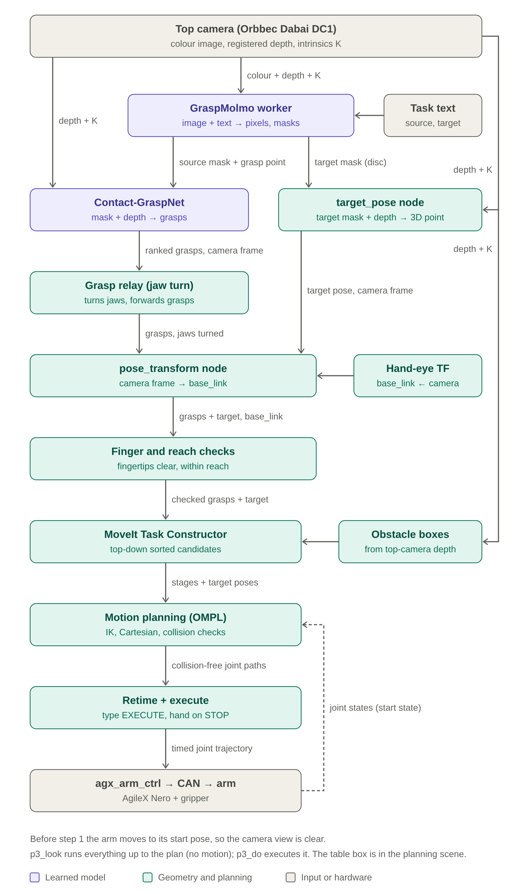
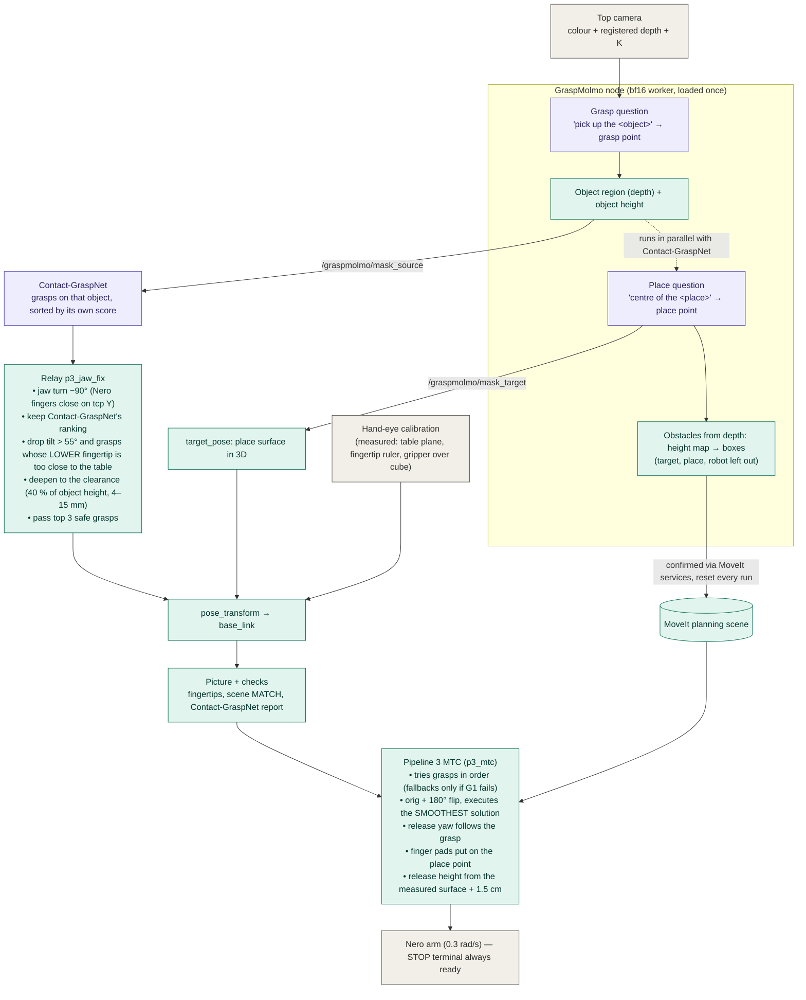

# Pipeline 3 — GraspMolmo + Contact-GraspNet (AgileX Nero)

Language-driven pick and place on the Nero 7-DOF arm: you name the object and the place
(`"eggplant"` → `"sink"`), **GraspMolmo** decides *which object* and *where*, **Contact-GraspNet**
proposes the grasps, and pipeline 3's own **MoveIt Task Constructor** plans and executes.
Runs on the AGX Orin (ROS 2 Humble, MoveIt 2), top camera Orbbec Dabai DC1.

 <!-- optional: the PNG from the "Knowledge" chat; the diagram below is the up-to-date one -->

## Flowchart



Purple = learned model · green = geometry and planning · grey = hardware / input.
`p3_look.sh` runs everything up to the plan (no motion); `p3_do.sh` executes it.

## Main improvements over pipeline 1 (Grounded-SAM-2 + Contact-GraspNet)

| Area | Pipeline 1 | Pipeline 3 |
|---|---|---|
| Which object / where | Grounded-SAM-2 mask (by name) | **GraspMolmo**: task-aware grasp point and place point from language |
| Grasp choice | least tilted of up to 6, re-centred onto the object top | **Contact-GraspNet's own ranking**, only unsafe grasps rejected; deepened to a safe clearance |
| Finger direction | grasp sent unconverted → fingers closed **90° off** | jaw turn −90° (verified: Nero fingers close on tcp_link Y) |
| Table safety | none for the fingertips | **both** fingertips checked; clearance adapts to object height (pen 4 mm … cube 15 mm) |
| Wrist motion | only the 180°-flipped grasp tried → wrist spun ~180° | both orientations, **smoothest** solution executed |
| Place | fixed yaw, gripper point on the target, height assumed a plate on the table | yaw follows the grasp, **finger pads** on the target, height from the **measured surface** (plate, cube top, sink floor) |
| Obstacles | table only | **height-map obstacles** from the camera (containers keep their inside free), confirmed in MoveIt every run |
| Calibration / table | tuned by eye; table assumed at z = 0 | **measured** (height, tilt, sideways); real table height stored (−10.9 mm, robot on a plate) |
| Speed | 0.1 rad/s, 15 s start move | 0.3 rad/s, 8 s start move; place question + obstacles run **in parallel** with Contact-GraspNet (~15 s faster) |

## Why there is no pipeline 2 in use

Pipeline 2 replaced Contact-GraspNet with **M2T2** (GraspMolmo choosing among M2T2's scene-wide grasps).
M2T2 produced **no grasps at all** for some objects (flat or unfamiliar ones such as tape and a carrot), so
the pipeline could not even attempt them. Pipeline 3 went back to Contact-GraspNet, which grasps whatever
region GraspMolmo points at, and kept GraspMolmo for the object and place selection. Pipeline 2's MTC
improvements (smoothest solution, release yaw following the grasp) were reused in pipeline 3's MTC.

## Quick start

```bash
~/nero_day_start.sh                                    # CAN link to the arm (once a day)
bash ~/Downloads/install_pipeline3.sh                  # after an update; must end with READY
# Terminal 1
bash ~/nero_pipeline_launch/pipeline3/p3_clean.sh
source ~/agx_arm_ws/install/setup.bash; unset TABLE_TOP_Z; export REAL_ARM=1 ARM_WAIT=30
cd ~/nero_pipeline_launch && CGN_RECENTRE=false ./start_pipeline3.sh
# Terminal 2
bash ~/nero_pipeline_launch/pipeline3/p3_ready.sh
bash ~/nero_pipeline_launch/pipeline3/p3_look.sh "eggplant" "sink"     # plan only: check the picture + RViz
bash ~/nero_pipeline_launch/pipeline3/p3_do.sh                         # execute (hand on STOP in Terminal 3)
```

Useful tools: `p3_calib_check.py` (measure / fix the calibration), `p3_objects.py` (object centres as the
camera sees them), `p3_scene.py show|clear` (what MoveIt really holds), `p3_grasp_watch.py` (3D viewer of
every Contact-GraspNet grasp). Versions of every file: `VERSIONS.txt`.
